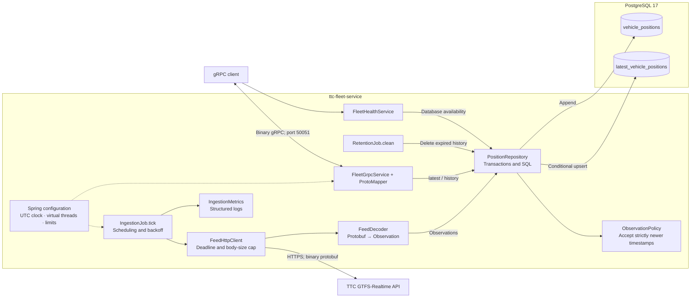

# TTC Fleet Service: Engineering Mental Model

## Executive summary

`ttc-fleet-service` is a single-module Maven backend running Java 21, Spring Boot 4.1.2, Spring gRPC/Netty, JDBC, Flyway, and PostgreSQL 17. Its core behavior has two independent paths: a background job converts TTC's binary GTFS-Realtime feed into stored observations, and gRPC handlers query those observations. The central invariant is that history and latest positions advance together in one transaction, accepting only newer vehicle timestamps. Start reading at `FleetApplication.main()`, then follow `IngestionJob.tick()` and `FleetGrpcService`. SQL and protobuf schemas define the durable contracts; virtual threads provide the blocking execution model.

## Architecture



## Project orientation

The main entry point is `src/main/java/ca/ttc/fleet/FleetApplication.java`. It enables component scanning, configuration-property scanning, and scheduling.

| Location | Responsibility |
| --- | --- |
| `src/main/java/ca/ttc/fleet/grpc` | Handles gRPC requests, validation, status mapping, health, and protobuf response mapping. |
| `src/main/java/ca/ttc/fleet/domain` | Holds immutable observation/filter records and the timestamp acceptance policy. |
| `src/main/java/ca/ttc/fleet/persistence` | Owns SQL, transactions, batch inserts, upserts, queries, and cleanup deletes. |
| `src/main/java/ca/ttc/fleet/ingestion` | Polls TTC, decodes GTFS-RT, applies retry delays, records metrics, and runs retention. |
| `src/main/java/ca/ttc/fleet/config` | Wires the UTC clock, virtual executor, HTTP client, gRPC executor, metrics, and validated settings. |
| `src/main/proto` | Contains the official GTFS-Realtime input schema and the service's external gRPC contract. |
| `src/main/resources` | Contains application defaults and Flyway migrations. |
| `src/test/java/ca/ttc/fleet` | Contains unit, PostgreSQL integration, in-process gRPC, and Netty runtime tests. |
| `pom.xml`, `.mvn`, `mvnw` | Define versions, protobuf generation, packaging, and test execution. |
| `Dockerfile`, `docker-compose.yml` | Define the ARM64-compatible image and the application/PostgreSQL deployment. |
| `target` | Contains generated sources, build artifacts, and test reports. Do not edit generated classes. |

### External systems and background work

- TTC's GTFS-Realtime vehicle-position feed is the only external API.
- PostgreSQL 17 is the only database.
- There is no queue, distributed cache, MCP server, or agent workflow in the repository.
- `IngestionJob.tick()` evaluates polling eligibility every second. Successful polls wait the configured interval; failures use exponential backoff with jitter.
- `RetentionJob.clean()` deletes expired history on the configured UTC cron schedule.
- `LoggingMeterRegistry` publishes metrics every minute when enabled.

## Component map

| Component | Responsibility | Key files | Depends on | Risk notes |
| --- | --- | --- | --- | --- |
| API/interface | Exposes latest/history streams and route snapshots; validates filters and translates failures into gRPC statuses. | `ttc_fleet.proto`, `FleetGrpcService`, `ProtoMapper` | Generated stubs, repository, configuration, clock | Ordering, cursors, field presence, limits, and status codes are client contracts. |
| Business/domain | Represents observations and filters; accepts only observations with strictly newer timestamps. | `Observation`, `PositionFilter`, `ObservationPolicy` | Java collections and time | Equal timestamps are discarded even if other values changed. Records do not validate themselves. |
| Ingestion orchestration | Coordinates fetching, decoding, persistence, retry delays, metrics, and concise logs. | `IngestionJob`, `PollBackoff`, `IngestionMetrics` | HTTP integration, decoder, repository, clock | The one-second scheduler is a gate around the actual poll interval. Overlapping polls are suppressed. |
| External integration | Retrieves bounded binary responses and converts GTFS vehicle entities into domain observations. | `FeedHttpClient`, `FeedDecoder`, `gtfs-realtime.proto` | JDK HTTP client, virtual executor, generated GTFS classes | Preserve the entire-response deadline and body-size cap. Keep entity rejection distinct from whole-feed failure. |
| Persistence | Provides `ingest`, `latest`, `history`, `deleteHistoryBatch`, and `isAvailable`. | `PositionRepository`, `V1__vehicle_positions.sql` | JdbcClient, batch JDBC, TransactionTemplate, PostgreSQL | Advisory locking, timestamp comparison, history insertion, and latest upsert form one correctness boundary. |
| Retention | Deletes history older than the source-time cutoff in bounded batches. | `RetentionJob`, `PositionRepository.deleteHistoryBatch()` | Repository, settings, clock | Latest rows deliberately survive cleanup because they are also ingestion checkpoints. |
| Health/observability | Implements gRPC health, the container probe, ingestion meters, and structured logs. | `FleetHealthService`, `HealthProbe`, `IngestionMetrics` | Spring readiness, PostgreSQL, Micrometer | Healthy means application readiness plus database connectivity; it does not guarantee fresh TTC data. |
| Configuration | Binds settings and provides shared infrastructure. | `TtcProperties`, `RuntimeConfiguration`, `MetricsConfiguration`, `application.yml` | Spring Boot | Explicit health/reflection services replace their corresponding auto-configured services. |
| Tests | Protects domain rules, persistence invariants, API behavior, and the virtual-thread execution model. | `*Test`, `*IT`, `PostgresIntegrationSupport` | JUnit, Mockito, Testcontainers, PostgreSQL, gRPC | `test` runs unit tests; `verify` also runs integration tests and requires Docker. |

## Representative flow: TTC feed to gRPC client

Polling and querying are separate operations. A client request reads PostgreSQL and never waits for TTC.

```mermaid
sequenceDiagram
    participant Scheduler
    participant Poll as IngestionJob
    participant HTTP as FeedHttpClient
    participant TTC
    participant Decoder as FeedDecoder
    participant Repo as PositionRepository
    participant Policy as ObservationPolicy
    participant DB as PostgreSQL
    participant Client
    participant API as FleetGrpcService

    Scheduler->>Poll: tick()
    Poll->>Poll: Check enabled, nextPoll, overlap guard
    Poll->>HTTP: fetch()
    HTTP->>TTC: GET binary feed
    TTC-->>HTTP: Feed bytes
    HTTP-->>Poll: Bounded byte[]
    Poll->>Decoder: decode(bytes, ingestedAt)
    Decoder-->>Poll: DecodedFeed + observations
    Poll->>Repo: ingest(observations)

    rect rgb(238, 245, 250)
        Note over Repo,DB: One database transaction
        Repo->>DB: Acquire advisory lock; read latest timestamps
        DB-->>Repo: Stored timestamps
        Repo->>Policy: acceptNewer(incoming, stored)
        Policy-->>Repo: Accepted observations
        Repo->>DB: Batch INSERT history
        Repo->>DB: Batch UPSERT latest
        Repo->>DB: Commit
    end

    Repo-->>Poll: Inserted row count
    Poll->>Poll: Record metrics; schedule next attempt

    Note over Client,API: Independent request after ingestion
    Client->>API: GetLatestVehiclePositions(filters, limit)
    API->>API: Validate request
    API->>Repo: latest(PositionFilter)
    Repo->>DB: SELECT latest_vehicle_positions
    DB-->>Repo: Bounded rows
    Repo-->>API: Observations
    API-->>Client: VehiclePosition messages; complete
```

### Step-by-step walkthrough

1. `IngestionJob.tick()` reads `ingestionEnabled`, `nextPoll`, and an atomic overlap guard. It proceeds only when polling is due. After the attempt, it stores the next eligible time.

2. `FeedHttpClient.fetch()` reads the feed URL, timeouts, and size limit. It performs the blocking HTTP request using the virtual-thread executor. A network error, non-200 response, oversized body, interruption, or full-response timeout throws before any database write.

3. `FeedDecoder.decode()` parses binary protobuf into `Observation` records. A vehicle timestamp takes precedence over the header timestamp. Optional fields stay absent when the feed omits them. Invalid vehicle entities are counted and skipped; a malformed/unsupported feed or a feed with rejected vehicles and no valid observations fails the poll.

4. `PositionRepository.ingest()` starts one transaction, applies a five-second lock timeout, takes PostgreSQL advisory lock `8847210051`, and reads existing timestamps from `latest_vehicle_positions`.

5. `ObservationPolicy.acceptNewer()` sorts incoming observations and retains every distinct timestamp that is strictly newer than the stored high-water mark for that vehicle. Equal and older observations are ignored.

6. `PositionRepository.batch()` appends accepted observations to `vehicle_positions` in batches of 500. It then upserts one newest accepted row per vehicle into `latest_vehicle_positions`. Any SQL failure rolls back both operations.

7. `IngestionJob.tick()` records committed row count, entity count, rejection count, duration, feed age, and success or failure. Failures trigger jittered exponential backoff capped at five minutes. A valid empty feed changes no positions.

8. `FleetGrpcService.getLatestVehiclePositions()` independently receives a protobuf request, validates filters and limits, and creates a `PositionFilter`. Invalid input returns `INVALID_ARGUMENT`.

9. `PositionRepository.latest()` selects from `latest_vehicle_positions`, ordered by vehicle ID and bounded by the requested/configured limit. It does not call TTC.

10. `ProtoMapper.position()` restores optional protobuf field presence. `FleetGrpcService.stream()` emits each record, observes cancellation between records, and completes the finite stream. A missing specifically requested vehicle returns `NOT_FOUND`; database failures return `UNAVAILABLE`; unexpected failures return `INTERNAL`.

History follows the same request path but selects `vehicle_positions`, ordered by source timestamp descending and vehicle ID ascending. Route snapshots query latest rows with `limit + 1` to determine whether another page exists.

## Design and conventions

The code uses package-based layering, constructor injection, immutable records, a pure domain policy, explicit SQL, and generated protobuf boundaries. There is no separate application-service layer between `FleetGrpcService` and `PositionRepository`.

Blocking work is intentional. Spring's scheduler, HTTP calls, gRPC handlers, and JDBC calls execute on virtual threads where configured. Hikari still bounds database concurrency. Netty I/O, the JDK HTTP selector, Hikari maintenance, and metrics publishing retain dependency-owned platform threads.

The two database tables serve different purposes:

- `vehicle_positions` is append-only history. Its primary key is `(vehicle_id, source_timestamp)`, and a trigger rejects updates.
- `latest_vehicle_positions` contains one row per vehicle. It serves current queries and stores the durable timestamp used to reject stale/duplicate ingestion.

This means the latest table is part of ingestion correctness, not merely a query optimization.

Pagination contracts are coupled to SQL ordering:

- Latest positions use ascending `vehicle_id` and an exclusive `after_vehicle_id` cursor.
- History uses descending `source_timestamp`, then ascending `vehicle_id`. Both cursor fields must be supplied together.
- Pages do not share a multi-request database snapshot, so concurrent ingestion can affect later pages.

## Where to add a new feature

| Change | Where it belongs | What to preserve |
| --- | --- | --- |
| Add an observed field | `FeedDecoder` → `Observation` → a new Flyway migration for both tables → repository bindings/mapping → service proto → `ProtoMapper` | Optional-field presence and consistent types across the full path. `LIKE` in V1 does not synchronize later schema changes. |
| Add a filter or RPC | `ttc_fleet.proto` → `FleetGrpcService` → `PositionFilter`/repository query | Request validation, bounded responses, parameterized SQL, deterministic ordering, cursor semantics, and gRPC statuses. |
| Change acceptance rules | `ObservationPolicy`, repository upsert conditions, uniqueness assumptions, and tests | The Java policy, SQL guard, primary key, and durable high-water mark must agree. |
| Change feed handling | `FeedHttpClient` or `FeedDecoder` | Entire-body deadline, allocation cap, timestamp precedence, and entity-versus-feed rejection behavior. |
| Add configuration | `TtcProperties`, `application.yml`, Compose environment mapping, `.env.example`, README | `.env` values are not passed into the container unless Compose references them. |
| Change retention | `RetentionJob`, repository deletion SQL, migration/indexes, integration tests | Keep the high-water mark unless deliberately changing duplicate-rejection semantics. |
| Change health behavior | `FleetHealthService`, `HealthProbe`, Docker/Compose checks | Feed outages currently leave the service healthy when stored data and PostgreSQL remain available. |

Run `./mvnw test` for focused domain and decoder work. Run `./mvnw verify` for changes involving SQL, protobuf contracts, Spring wiring, gRPC behavior, configuration, or threading; it requires Docker because integration tests use PostgreSQL 17 through Testcontainers.

## Risk areas and hidden coupling

- **Transaction and advisory lock:** timestamp comparison, history insertion, and latest upsert must remain atomic across concurrent pollers. The implementation assumes PostgreSQL READ COMMITTED behavior after acquiring the transaction-scoped lock.
- **Latest-state semantics:** latest means the most recently accepted observation, with no automatic expiry. Deleting latest rows allows older observations to be accepted again.
- **Schema evolution:** add new migrations rather than modifying an applied migration. Update both tables explicitly when adding fields.
- **Protobuf compatibility:** preserve field numbers and optional presence. Generated Java under `target` is not source code to edit.
- **Pagination:** changing sort order requires changing cursor meaning, SQL predicates, documentation, and tests together.
- **Resource limits:** queries materialize bounded lists before streaming. Raising the 1,000-record ceiling increases database work and memory use. Virtual threads do not increase the default eight-connection pool.
- **Starter wiring:** `pom.xml` deliberately combines the legacy Spring gRPC starter's Netty dependencies with Boot 4.1's server starter while excluding obsolete auto-configuration. Casual dependency cleanup can create duplicate or missing server configuration.
- **Timestamp semantics:** the same source timestamp is the history identity and stale-observation checkpoint. Corrections with an unchanged timestamp are ignored.

## Open questions and assumptions to verify

- **Inferred — verify.** TTC timestamps reliably identify newer information. The code discards corrections carrying an equal or older timestamp, but the repository cannot establish the upstream guarantee.
- **Inferred — verify.** Consumers accept indefinitely retained latest rows and evaluate freshness using `source_timestamp`. The code implements this behavior, but no acceptable freshness threshold is encoded.
- **Inferred — verify.** The hard-coded five-minute future-timestamp tolerance is appropriate for production clock conditions.
- **Inferred — verify.** The target VM has sufficient storage and I/O for the configured retention period. Tests establish correctness rather than sustained-load capacity.
- **Inferred — verify.** Production firewall rules, backups, and deployed configuration match the README. The repository contains deployment instructions, not evidence of the live environment.
